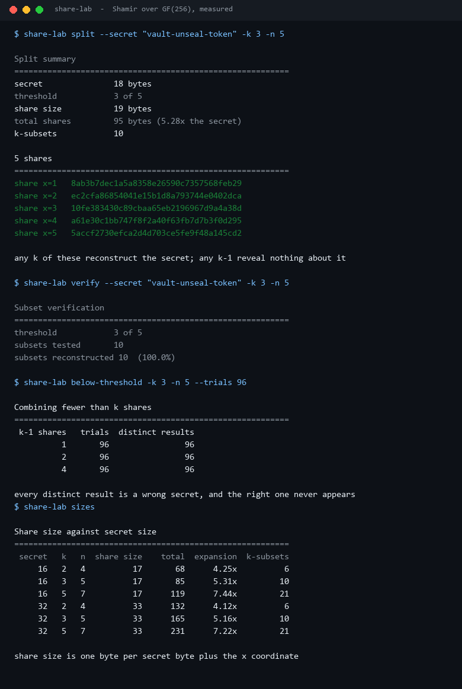
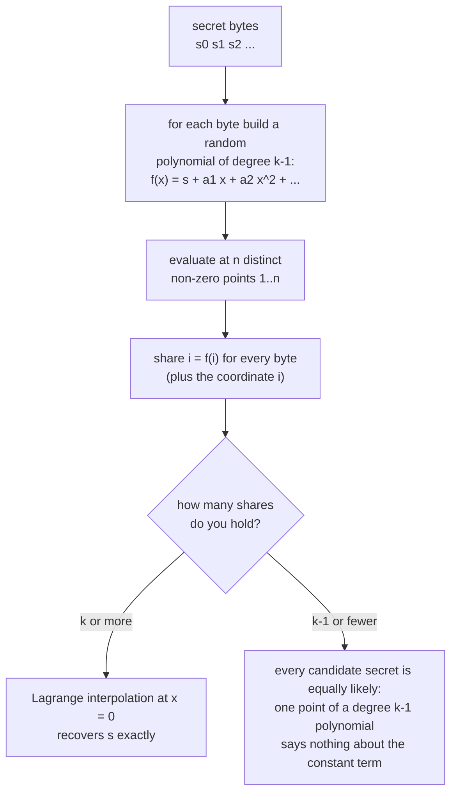
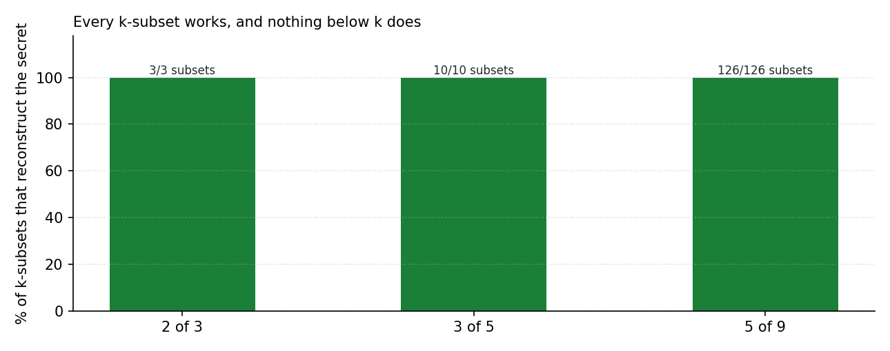
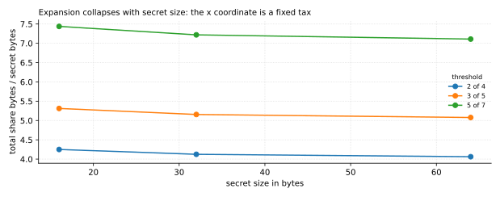

# Threshold-Share-Lab

**Splits a secret k-of-n with Shamir secret sharing over GF(2^8), then proves the two claims that
matter: every k-subset reconstructs it, and every k-1 subset produces a different wrong answer.**

No `secretsharing` package, no big-integer maths - one byte per coefficient, table-driven field
arithmetic, and a measurement for each claim.



All numbers come from `scripts/render_assets.py` running this repository's code. The demo secret is
the literal string `vault-unseal-token`; nothing from your machine is read.

---

## Table of contents

- [Why this exists](#why-this-exists)
- [The scheme in one diagram](#the-scheme-in-one-diagram)
- [The GF(256) trap that this code had to fix](#the-gf256-trap-that-this-code-had-to-fix)
- [Every k-subset works, measured](#every-k-subset-works-measured)
- [What k-1 shares actually give you](#what-k-1-shares-actually-give-you)
- [What sharing costs](#what-sharing-costs)
- [Install and run](#install-and-run)
- [Commands](#commands)
- [Design notes and limits](#design-notes-and-limits)
- [Tests](#tests)
- [License](#license)

---

## Why this exists

"We store the key in a vault" is a single point of failure with a single point of trust. Threshold
sharing replaces it with a quorum: any 3 of 5 operators can rebuild the key, no 2 of them can, and
nobody has to trust the person next to them.

The algorithm is from 1979 and fits in a page. What people get wrong is the **field**: you need
arithmetic where every non-zero byte is invertible, and getting the tables slightly wrong produces a
scheme that "works" in a demo and silently fails on real shares. Both claims are worth measuring:

1. **completeness** - do *all* k-subsets reconstruct?
2. **secrecy** - do k-1 subsets produce genuinely unrelated values, not "almost the key"?

## The scheme in one diagram



Reconstruction is the standard Lagrange formula evaluated at zero, which needs only field
multiplication, addition (XOR) and inversion - all table lookups here.

## The GF(256) trap that this code had to fix

The first implementation built its log/antilog tables by repeatedly doubling, which is the textbook
recipe... for a *different* polynomial. For AES's `0x11B`, the element `2` has multiplicative order
**51**, not 255, so the "log table" has only 51 distinct entries and every multiplication is wrong.
The symptom was wonderfully subtle:

- splitting "worked" and printed shares;
- shares `x=1`, `x=3` and `x=5` came out **identical**;
- reconstruction from 3 shares returned `0x0101...` instead of the secret;
- the verify command reported **0 of 10** subsets reconstructed.

The fix is one line of intent - use a generator with full order:

```python
doubled = value << 1
if doubled & 0x100:
    doubled ^= POLYNOMIAL
value ^= doubled          # multiply by 3: x*3 == x*2 ^ x
```

There is a regression test for it (`test_generator_has_full_order` asserts 255 distinct antilogs),
because this class of bug is invisible to a demo that only prints shares.

## Every k-subset works, measured



| Configuration | Subsets tested | Reconstructed | Success |
| --- | ---: | ---: | ---: |
| 2 of 3 | 3 | 3 | 100% |
| 3 of 5 | 10 | 10 | 100% |
| 5 of 9 | 126 | 126 | 100% |

`share-lab verify` enumerates **every** k-subset and reconstructs each one, rather than testing one
lucky combination. At 5-of-9 that is 126 reconstructions, each of which has to agree byte for byte
with the original secret.

## What k-1 shares actually give you



The secrecy claim is not "it looks random" - it is that combining *fewer* than k shares yields a
value that is unrelated to the secret, and that different subsets yield *different* values:

| Holding | Trials | Distinct results | Equals the secret |
| --- | ---: | ---: | --- |
| 1 share of 2-of-3 | 96 | **96** | never |
| 2 shares of 3-of-5 | 96 | **96** | never |
| 4 shares of 5-of-9 | 96 | **96** | never |

96 trials produced 96 distinct values, none of them the secret. Under the scheme, holding k-1
shares leaves exactly one free coefficient per byte - a keyspace of `256**(k-1)` candidates - and
this is what that looks like when you actually evaluate it instead of asserting it in prose.

## What sharing costs

| Secret | k of n | Share size | Total share bytes | Expansion | k-subsets |
| ---: | --- | ---: | ---: | ---: | ---: |
| 16 B | 2 of 4 | 17 | 68 | 4.25× | 6 |
| 16 B | 3 of 5 | 17 | 85 | 5.31× | 10 |
| 16 B | 5 of 7 | 17 | 119 | 7.44× | 21 |
| 32 B | 3 of 5 | 33 | 165 | 5.16× | 10 |
| 64 B | 3 of 5 | 65 | 325 | 5.08× | 10 |
| 64 B | 5 of 7 | 65 | 455 | 7.11× | 21 |

Two things worth noticing:

- **Share size is one byte per secret byte, plus one.** There is no blow-up in size, only in
  count - a 32-byte AES key produces 33-byte shares.
- **Expansion is dominated by the number of shares, not the secret size.** Going from 5 to 7 shares
  costs 44% more total bytes whatever the secret is; going from a 16-byte to a 64-byte secret costs
  *less* expansion because the fixed one-byte coordinate gets amortised.

For a 3-of-5 policy on a 32-byte key: 165 bytes of shares, 10 valid combinations, and 256² ≈ 65,536
candidate secrets for an attacker holding any two shares.

## Install and run

Standard library only.

```bash
python -m pip install -e ".[dev]"
share-lab split --secret "hello" -k 3 -n 5
```

From a checkout without installing:

```bash
PYTHONPATH=src python -m threshold_share_lab split --secret "hello" -k 3 -n 5
```

Round trip on the command line:

```bash
share-lab split --secret "recover-me" -k 3 -n 4 --format json
share-lab combine --share "1:<hex>" --share "2:<hex>" --share "4:<hex>"
```

## Commands

| Command | What it answers |
| --- | --- |
| `split [-k K] [-n N] [--secret S \| --secret-hex H \| --secret-bytes B]` | produce shares |
| `verify` | reconstruct from every k-subset and report the success rate |
| `combine --share x:hex ...` | rebuild the secret from a set of shares |
| `below-threshold [-k K] [--trials T]` | what k-1 shares actually produce |
| `sizes` | share size, expansion and subset count against parameters |

## Design notes and limits

- **GF(2^8) is not a general-purpose choice.** 255 shares maximum is fine for people, too few for
  large fleets; a scheme over GF(2^16) or with a larger field trades share size for headroom.
- **Randomness comes from `secrets.SystemRandom`.** The tests and the asset generator inject a
  seeded `SystemRandom` so the committed numbers are reproducible; a production caller should pass
  nothing and get the OS entropy pool.
- **Shares are not authenticated.** Anyone can hand you a corrupted share and reconstruction will
  happily produce garbage. Verifiable secret sharing (commitments, as in Feldman or Pedersen VSS)
  is the next step; this project deliberately implements the plain scheme so the maths is visible.
- **No metadata integrity.** Real deployments encrypt shares, bind them to an identity, and store
  the (k, n, x) parameters alongside; here the share is just `x || payload`.
- **This is a lab, not a KMS.** Use it to understand and to measure; use a reviewed library and a
  hardware-backed store for real key material.
- **Nothing sensitive is stored in the repository.** The demo secret is a fixed public string and
  the shares in `docs/results.json` are shares of it.

## Tests

```bash
PYTHONPATH=src python -m pytest -q     # 45 passed
python -m ruff check .                 # All checks passed!
```

45 tests cover the field arithmetic (a full inverse round trip over all 255 elements, plus the
generator-order regression test), split/combine for 1-byte to multi-byte secrets in any share order,
every rejection path (empty secret, k<2, n<k, n>255, duplicate coordinates, mismatched lengths,
zero coordinate), subset enumeration, below-threshold spread, the size table, every report and every
CLI command including the `combine` round trip.

## License

MIT. See [LICENSE](LICENSE).

---

<sub>Screenshots and charts are generated by `scripts/render_assets.py` from this repository's own
output. No third-party images are used.</sub>
